# 昇腾算子下发微基准测试与裸机/虚机对比分析报告

> **测试项目路径**：`xuji_luoji_test/env_conf/1029/算子下发demo验证`  
> **对比环境**：裸机（`bare192`，EulerOS 2.13，192 核，NUMA 0~7） vs 虚机（`vm144`，EulerOS 2.15，144 vCPU，NUMA 0~3）  
> **测试芯片**：Huawei Ascend 910B4 (测试卡：Device 0、Device 6)  
> **测试软件栈**：CANN 9.1.0、PyTorch 2.10.0+cpu、torch_npu 2.10.0 (bare: post4, vm: post6)

---

## 一、 项目背景与测试目标

### 1.1 背景痛点
在大语言模型推理系统（如 vLLM / AICO）的实际部署中，虚机环境相较于裸机往往出现较为显著的吞吐下降与端到端时延拉长。由于实际模型运行中耦合了：
- vLLM 复杂的调度器与批处理机制（Scheduler / Batching）；
- HCCL 多卡集合通信（AllReduce / P2P）；
- 跨主机/跨 NUMA 的张量与权重搬运；
- 动态形状与多层融合 Kernel。

这些因素相互交织，导致无法快速判断性能差距的根本来源：**究竟是 NPU 芯片算力在虚拟化下受到影响，还是 CPU 侧驱动/Runtime 的调度与下发开销被放大了？**

### 1.2 微基准验证目标
为了精准回答上述问题，本项目设计并执行了**纯净受控的单卡微基准测试（[`bench.py`](file:///Users/zhangfan/project/aico_timedelay_report/xuji_luoji_test/env_conf/1029/算子下发demo验证/bench.py)）**：
1. **彻底剥离干扰**：不加载 vLLM、不加载任何权重、不进行多卡通信、不进行计时内内存分配与数据传输。
2. **聚焦单一路径**：纯粹测量 `Python → torch_npu → CANN → NPU` 这条 Host 准备与任务下发链路。
3. **定位关键接口**：通过正式无 Profiler 计时测量稳态延迟，辅以独立短 Profiler 捕获真实的 CANN 底层 API（如 `aclrtLaunchKernelWithHostArgs`）与 NPU 硬件 Kernel 执行耗时。

---

## 二、 测试方案与验证逻辑

### 2.1 算例与张量设计
| 算例 | 核心操作 | 张量 Shape / Dtype | 设计初衷 |
|---|---|---|---|
| **sub8** | `torch.sub(x, y, out=z)` | INT32 `[8]` | 对应线上 Trace 中高频出现的极短 Sub 算子，计算量极小（~1 μs），极限放大 Host 下发与调度开销。 |
| **add1024** | `torch.add(x, y, out=z)` | FP32 `[1024]` | 常用短加法算子，验证性能差距是否普遍存在于基础向量算子路径。 |

- **防干扰机制**：输入数据恒定预设为 7 和 2；输出张量在计时区外提前预分配并保持常驻，循环写同一输出；循环体内无任何 Python 打印、`.item()` 标量转换或 CPU↔NPU 传输。

### 2.2 队列模式设计（`TASK_QUEUE_ENABLE`）
测试显式覆盖了两个队列模式，每个模式均在独立的全新 Python 进程中启动：
- **Queue 1（`TASK_QUEUE_ENABLE=1`）**：生产运行默认配置。Host 启用多线程异步队列，主线程将任务推入 TaskQueue，后台 `acl_thread` 负责出队并调用 CANN 下发。
- **Queue 0（`TASK_QUEUE_ENABLE=0`）**：关闭 Host 异步队列，主线程直接调用 CANN 驱动下发。用于彻底剥离多线程队列交接、条件变量通知等干扰。

### 2.3 严格的 CPU / NUMA 绑核控制
依据 [`placements.json`](file:///Users/zhangfan/project/aico_timedelay_report/xuji_luoji_test/env_conf/1029/算子下发demo验证/placements.json)，新建的微基准进程在初始化 NPU 前严格绑定到卡所属的本地物理/虚拟核，防止跨 NUMA 与跨核漂移：
- **裸机（`bare192`）**：
  - Device 0：主线程核池 `146-165`，ACL 专用核 `166`，Release 专用核 `167`（NUMA 6）。
  - Device 6：主线程核池 `50-69`，ACL 专用核 `70`，Release 专用核 `71`（NUMA 2）。
- **虚机（`vm144`）**：
  - Device 0：主线程核池 `110-123`，ACL 专用核 `124`，Release 专用核 `125`（NUMA 3）。
  - Device 6：主线程核池 `38-51`，ACL 专用核 `52`，Release 专用核 `53`（NUMA 1）。

### 2.4 测试流程与指标含义
每个子任务独立运行：
`环境检查 → 200次预热 → 角色绑核 → 200次再次预热 → 正式无 Profiler 计时（Batch=1/32/256 各 20 轮） → 正确性校验 → 独立 128 次 Short Profiler`。

- **`submit_us_per_op`（Host 提交循环墙钟）**：前台 Python 循环调用并返回的单算子耗时（在 Queue 1 下主要反映入队开销；在 Queue 0 下反映同步下发开销）。
- **`drain_us_per_op`（末尾同步等待）**：批次结束时调用 `synchronize()` 的等待时间摊销到每个算子上，反映 NPU 计算与后台下发未排空的积压延迟。
- **`total_us_per_op`（提交至完成总耗时）**：整批任务从提交到全部硬件执行完成的端到端单算子耗时。
- **`aclrtLaunchKernelWithHostArgs`**：Profiler 捕获的底层 CANN 实际向 NPU 提交任务的核心 API 耗时。

---

## 三、 核心测试结果与数据对比

### 3.1 NPU 硬件计算耗时对比（0% 虚拟化损耗）
从设备硬件 Profiler Trace 中提取的 AI Vector Core 真实 Kernel 执行时间（P50，单位：μs）：

| 算例 | Device | Task queue | Kernel 名称 | 核心类型 | 裸机 P50 | 虚机 P50 | 虚机/裸机 比值 |
|---|---:|---:|---|---|---:|---:|---:|
| **add1024** | 0 | 0 | `aclnnAdd_AddAiCore_Add` | AI_VECTOR_CORE | **1.27 μs** | **1.28 μs** | **1.008x** |
| **add1024** | 0 | 1 | `aclnnAdd_AddAiCore_Add` | AI_VECTOR_CORE | **1.28 μs** | **1.26 μs** | **0.984x** |
| **add1024** | 6 | 0 | `aclnnAdd_AddAiCore_Add` | AI_VECTOR_CORE | **1.28 μs** | **1.27 μs** | **0.992x** |
| **add1024** | 6 | 1 | `aclnnAdd_AddAiCore_Add` | AI_VECTOR_CORE | **1.26 μs** | **1.28 μs** | **1.016x** |
| **sub8** | 0 | 0 | `aclnnSub_SubAiCore_Sub` | AI_VECTOR_CORE | **1.20 μs** | **1.18 μs** | **0.983x** |
| **sub8** | 0 | 1 | `aclnnSub_SubAiCore_Sub` | AI_VECTOR_CORE | **1.19 μs** | **1.20 μs** | **1.008x** |
| **sub8** | 6 | 0 | `aclnnSub_SubAiCore_Sub` | AI_VECTOR_CORE | **1.20 μs** | **1.20 μs** | **1.000x** |
| **sub8** | 6 | 1 | `aclnnSub_SubAiCore_Sub` | AI_VECTOR_CORE | **1.20 μs** | **1.18 μs** | **0.983x** |

> **关键发现 1**：  
> **NPU 硬件本身的算子计算耗时在虚机和裸机上完全重合（比值 0.98x ~ 1.01x）**，单算子周期数（Cycles）亦完全一致（约 1230 cycles）。这决定性地证明：**虚拟化直通对 Ascend 芯片本身的计算流水线没有任何性能损失。**

---

### 3.2 CANN ACL API 耗时对比（性能恶化的关键爆发点）
独立 Profiler 抓取的 CANN 层 API 执行耗时（P50，单位：μs）：

| 算例 | Device | Queue | CANN API 名称 | 裸机 P50 | 虚机 P50 | 虚机/裸机 比值 | 绝对差距 (μs/op) |
|---|---:|---:|---|---:|---:|---:|---:|
| **add1024** | 0 | 0 | `aclrtLaunchKernelWithHostArgs` | 5.30 | 17.33 | **3.27x** | **+12.03** |
| **add1024** | 0 | 0 | `aclnnAdd` | 9.69 | 22.99 | **2.37x** | **+13.30** |
| **add1024** | 0 | 1 | `aclrtLaunchKernelWithHostArgs` | 3.16 | 12.96 | **4.10x** | **+9.80** |
| **add1024** | 0 | 1 | `aclnnAdd` | 6.30 | 17.05 | **2.71x** | **+10.75** |
| **sub8** | 0 | 0 | `aclrtLaunchKernelWithHostArgs` | 5.11 | 16.54 | **3.24x** | **+11.43** |
| **sub8** | 0 | 0 | `aclnnSub` | 9.29 | 22.16 | **2.39x** | **+12.87** |
| **sub8** | 0 | 1 | `aclrtLaunchKernelWithHostArgs` | 4.42 | 13.49 | **3.05x** | **+9.07** |
| **sub8** | 0 | 1 | `aclnnSub` | 8.04 | 17.72 | **2.21x** | **+9.68** |

> **关键发现 2**：  
> - 底层下发核心接口 **`aclrtLaunchKernelWithHostArgs` 在虚机上放大了 2.8x ~ 4.1x**（裸机 ~3~5 μs，虚机 ~13~17 μs，单次算子产生 **8 ~ 12 μs 的额外 Host 延迟**）。
> - 高层接口 `aclnnAdd` / `aclnnSub` 的总增量中，有 **85% ~ 92% 的时间直接对应于 `HostArgs` 下发接口的增加**。这直接将性能瓶颈精确锁定在 CANN 驱动与底层下发调用上。

---

### 3.3 无 Profiler 正式计时（稳态 Batch=256 与 Batch=1 对比）
正式计时测量中位数（单位：μs/操作）：

| 队列模式 | 算例 | 指标 (μs/op) | Batch=1 (裸 / 虚 / 比值) | Batch=256 (裸 / 虚 / 比值) | 现象与行为分析 |
|---|---|---|---|---|---|
| **Queue = 0** (同步直接下发) | **add1024** (Dev0) | Host 提交循环墙钟 末尾同步等待 **总耗时 (Total)** | 40.6 / 64.4 (**1.59x**) 38.9 / 61.4 (**1.58x**) 84.9 / 132.4 (**1.56x**) | 15.7 / 33.2 (**2.11x**) 0.22 / 0.29 (**1.32x**) **16.0 / 33.5 (2.10x)** | 在同步直发模式下，由于没有队列积压，末尾同步等待极低。虚机端到端耗时呈现稳定的 **2.1 倍慢**，单步纯 CPU 下发时间翻倍。 |
| | **sub8** (Dev0) | Host 提交循环墙钟 末尾同步等待 **总耗时 (Total)** | 42.7 / 63.9 (**1.50x**) 35.9 / 62.2 (**1.73x**) 84.5 / 129.4 (**1.53x**) | 15.1 / 31.2 (**2.07x**) 0.24 / 0.29 (**1.17x**) **15.4 / 31.5 (2.05x)** | 与 add1024 表现一致，稳定在 **2.05 倍差距**。 |
| **Queue = 1** (异步 TaskQueue) | **add1024** (Dev0) | Host 提交循环墙钟 **末尾同步等待** **总耗时 (Total)** | 29.7 / 51.4 (**1.73x**) 35.6 / 108.7 (**3.05x**) 69.7 / 166.1 (**2.38x**) | 12.0 / 8.18 (0.68x) **0.21 / 8.40 (40.01x)** **12.3 / 16.7 (1.36x)** | **极其关键的现象**：Batch=256 时，虚机 Python 前台提交非常快（8.18 μs，仅入队），但末尾同步等待出现 **40 倍暴增**！说明后台消费线程跟不上。 |
| | **sub8** (Dev0) | Host 提交循环墙钟 **末尾同步等待** **总耗时 (Total)** | 28.9 / 48.7 (**1.68x**) 36.1 / 110.7 (**3.06x**) 70.5 / 163.5 (**2.32x**) | 6.91 / 8.77 (1.27x) **0.46 / 7.96 (17.33x)** **7.46 / 16.79 (2.25x)** | 虚机在小算子上端到端整体**劣化 2.25 倍**，大部分时间被排空等待吞噬。 |

---

### 3.4 硬件流跨度与“断粮”严重性
针对连续执行 128 次算子的 NPU Stream 跨度（First Kernel Start 到 Last Kernel End）分析：

```mermaid
xychart-beta
    title "128 次算子 NPU 硬件流总跨度对比 (μs, 越小越好)"
    x-axis ["add1024 (q0)", "add1024 (q1)", "sub8 (q0)", "sub8 (q1)"]
    y-axis "Stream Span (μs)" 0 --> 6500
    bar [3419, 1521, 3140, 1548]
    bar [5797, 2634, 5498, 2791]
```

- **实际 NPU 计算忙碌时间**：128 个算子在 NPU 上只需 **153 ~ 165 μs** 的硬件算力。
- **裸机表现**：Queue 1 下完成整批需要 1.52 ms，硬件利用率约 **10.8%**。
- **虚机表现**：Queue 1 下完成整批需要 2.63 ~ 2.79 ms（**拉长 1.73x ~ 1.80x**），硬件利用率仅 **5.5% ~ 6.2%**。
- **结论**：虚机下 NPU 有 **超过 94% 的时间处于无算可算的“饥饿/断粮”状态**，都在等待 Host 提交任务。

---

## 四、 核心机制剖析：为什么虚机下发显著滞后？

经过环境与软件基准核对：
1. **纯 Python 解释器耗时无差别**：`measure_batch(lambda: None, lambda: None, 256)` 基准显示，裸机与虚机单次 Python 循环开销均为 **0.05 μs (50 ns)**。
2. **CANN 库二进制完全一致**：`libascendcl.so`、`libopapi_*.so` SHA256 校验 100% 相同。
3. **CPU 硬件相同**：同为鲲鹏 920，主频一致。

因此，导致 `aclrtLaunchKernelWithHostArgs` 变慢以及 Queue 1 严重积压的根本技术机理如下：

### 1. PCIe MMIO Doorbell 寄存器写入触发虚拟机陷出（VM-Exit）
算子在 Host 侧完成参数打包后，最终需要向 PCIe BAR 空间对应的硬件 Doorbell 寄存器写入指令，唤醒 NPU 硬件调度引擎读取 SQ（Submission Queue）。
- **裸机**：CPU 发起 MMIO 写操作，PCIe 控制器直接将事务包发往硬件，耗时极短且无系统软件拦截。
- **虚机（PCIe Passthrough / VFIO）**：
  - 对特定 PCIe 物理寄存器的访问受 Stage-2 页表控制，易触发 **VM-Exit（虚拟机陷出）** 或受限于 IOMMU/SMMU 翻译和非缓存（Uncacheable, UC）内存属性约束。
  - 这种虚拟化陷出与上下文切换在每秒数万次的极高频算子下发时，会累加产生数微秒级别的固定惩罚。

### 2. HostArgs DMA 跨层地址转换
`LaunchKernelWithHostArgs` 需将位于 Host 内存中的算子参数/Tiling 信息暴露给 NPU 通过 DMA 读取。在虚机环境下，Guest 物理地址（GPA）到 Host 物理地址（HPA）的嵌套映射加重了 IOMMU DMA 映射与内存屏障开销。

### 3. TaskQueue 消费能力倒挂引发的“反压与排空风暴”
在 `TASK_QUEUE_ENABLE=1` 下：
- **裸机**：`acl_thread` 消费下发一次仅耗时 **3.16 μs**，快于前台 Python 逻辑构造速度，队列几乎随进随出。在 Batch 结束时，队列内几乎无残余任务，`synchronize()` 仅需 **0.21 μs**。
- **虚机**：`acl_thread` 消费下发一次耗时剧增到 **12.96 μs**。前台 Python 主线程以 ~8 μs 的速率快速将任务塞入队列，消费端严重滞后，队列快速积压。在 Batch 结束调用 `synchronize()` 时，前台被迫停下并陷入长时间的睡眠等待（`drain_us_per_op` 暴涨至 **8.40 μs**）。
- 同时从 `threads.json` 记账可见，虚机中辅助释放线程（`release_thread`）的调度排队等待时间从裸机的 **2.2 ms** 激增至 **11.6 ms**，进一步印证了虚拟化调度延迟对多线程协作的负面影响。

---

## 五、 结论与后续行动建议

### 5.1 明确结论

| 评价维度 | 结论定性 | 核心证据 |
|---|---|---|
| **NPU 硬件算力** | **完全无损（1.00x）** | 两个算例在 AI Vector Core 上的实际 Kernel 执行时间完全相同（1.20 μs vs 1.18 μs）。 |
| **单算子下发开销** | **严重劣化（2.5x ~ 4.1x）** | 底层 `aclrtLaunchKernelWithHostArgs` 从 3.16 μs 劣化至 12.96 μs（单算子额外开销 8~12 μs）。 |
| **业务形态敏感度** | **短算子致命，大算子脱敏** | 对小算子密集型、短 Token 生成、非融合操作，虚机性能断崖式下跌；对长时间 GEMM 算子，下发开销会被计算完全掩盖。 |

### 5.2 后续优化与排查建议

1. **底层虚拟化配置协同排查（重点方向）**：
   - 结合当前的 `PCIe BAR_uc_wc` 探针测试，深入核实宿主机 KVM 对于 NPU 设备 BAR 空间的内存属性配置（**Write-Combining vs Uncacheable**）。确保 MMIO 写入采用 WC 属性合并写缓冲区，避免频繁触发流水线清空和总线阻塞。
   - 检查虚拟化中断直通（vGIC/MSI-X 直通）与 SMMU Stage-2 硬件辅助配置，尽量降低 MMIO 陷出开销。
2. **算子下发路径优化与降频**：
   - 在上层推理框架（如 vLLM/MindIE）中，开启算子自动融合（Kernel Fusion）、TorchDynamo / ACL Graph 捕获。
   - **核心思路**：既然在虚机中“单次下发的固定成本无法降低（~15 μs）”，就必须“大幅减少跨 Host-Device 的下发总次数”，通过融合成大算子或整图执行将 NPU 流水线打满。
