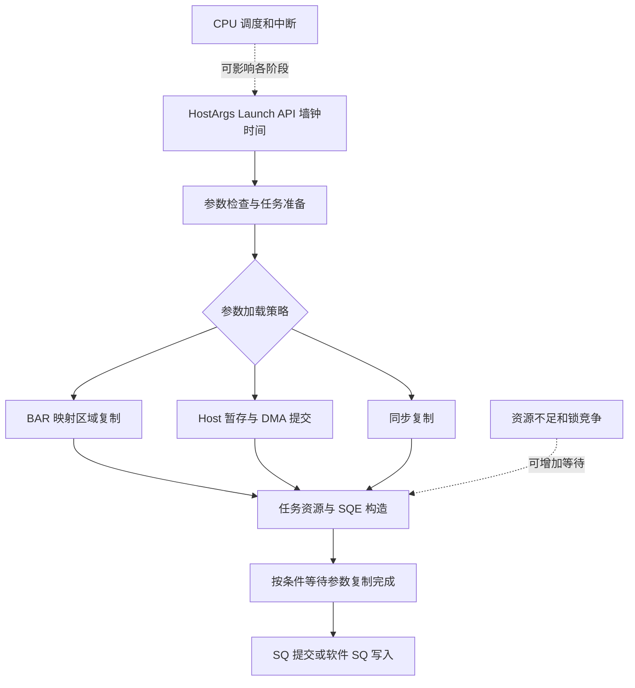

# aclrtLaunchKernelWithHostArgs 下发耗时综合分析结论

日期：2026-10-26

综合依据：

- [文档 A：Runtime 源码及 profiling 白盒分析](aclrtLaunchKernelWithHostArgs_白盒分析报告.md)
- [文档 B：结合虚拟化环境的下发耗时分析](aclrtLaunchKernelWithHostArgs下发耗时白盒分析报告.md)
- 交叉核查：[10 月 26 日宿主检查日志](../test/host_isolation_check_20261026_163615.log)、[检查脚本](../test/check_host_isolation.sh)、[144 vCPU XML](../xml_config_luoji/instance-00000b34.144vcpu.xml)、[原始数据库复算结果](../../outputs/launch_whitebox_20261026/evidence.json)。

## 一、综合判断

**已经确认的是：虚机存在显著的 Host/Runtime 下发开销，表现为全 rank 的常态下发变慢、rank 间差异和少量长尾叠加。源码给出了参数搬运、参数完成等待、资源回收、锁和 SQ 提交等具体可疑位置；宿主检查进一步提供了调度与中断干扰的环境线索，但尚不足以将某一机制认定为确定根因。**

综合后的排查重点应分成两条同时推进的线：

1. **解释主要均值差距：** 先测 HostArgs 的 BAR/DMA/同步拷贝分支与完成等待，再测 SQ 提交。这条线最直接回答“为什么每次普遍多几十微秒”。
2. **解释波动与 rank 差异：** 对齐 Launch 线程、来宾 vCPU、宿主 pCPU 的调度和中断，核验 CPU—内存—NPU 的实际位置。这条线有新增环境证据，但仍需同窗口关联。

内存页大小、MMIO 陷入和 NUMA 错配保留为待检验机制，不能把四种假设直接相加，宣布已经完成根因闭环。

## 二、两份文档可以共同确认的事实

| 指标 | 裸机 rank 0 | 虚机 rank 0 | 综合解释 |
|---|---:|---:|---|
| Launch 次数 | 9931 | 9206 | 工作量与采集窗口不完全相同 |
| 单次平均 | 7.08 μs | 48.34 μs | 约 6.83 倍，异常明确 |
| P50 | 6.46 μs | 43.27 μs | 多数调用都变慢，非少数离群值造成 |
| P95 | 13.35 μs | 98.06 μs | 高分位同步恶化 |
| 最大值 | 43.77 μs | 4481.89 μs | 存在额外毫秒级长尾 |
| 去除 ≥1 ms 后平均 | 7.08 μs | 47.56 μs | 主要差距仍在，约 6.72 倍 |
| API 累计 | 70.28 ms | 445.02 ms | 原始累计差为 374.74 ms，不等于端到端贡献 |

虚机 rank 0 三次 ≥1 ms 的调用总计 7.368 ms，仅占 Launch 累计的 **1.66%**。即使消除这三次长尾，也无法消除主要下发差距。最小值 17.41 vs 2.00 μs 是分布下沿不同的线索，不能据两个不同调用的最小值断言“每次固定增加 15.41 μs”，更不能将其直接归给 MMIO。

按 kernel 名称、输入输出 shape/dtype/format、任务类型、block 数匹配后仍有明显差异。例如 Sub `[8]` 的 P50 为 41.86 vs 6.17 μs，SelectV2 `[64]` 为 25.41 vs 5.60 μs。形状差异不能解释全部异常；实际参数字节数、tiling、二进制和执行阶段仍未完全控制。

| 虚机 rank | 平均 μs | P50 μs | 累计 ms |
|---|---:|---:|---:|
| 0 | 48.34 | 43.27 | 445.02 |
| 1 | 46.50 | 42.65 | 428.06 |
| 2 | 44.51 | 39.095 | 409.75 |
| 3 | 42.24 | 38.81 | 388.87 |

最快的虚机 rank 仍明显慢于裸机 rank 0；rank 0 又比 rank 3 多 6.10 μs/次、累计多 56.15 ms。因此“全 rank 共同成本”和“rank 间附加差异”应分开解释。这不是已经完成的因果分解，也不代表两类耗时可以直接相加到业务时延上。

RecordEvent、StreamWaitEvent、MemcpyAsync 的平均耗时分别约放大 1.81、1.79、1.54 倍，远小于 Launch 的 6.83 倍。这使 kernel 特有的参数处理路径更值得优先检查，但不能完全排除 CPU 调度对不同 API 的不同比例影响。

## 三、统一的白盒机制解释

这是逻辑示意，具体参数加载与任务分配次序随分支变化。参考源码主链是 `rtsLaunchKernelWithHostArgs → LaunchKernelV2 → StreamLaunchKernelV2 → StarsAllocTaskAndSend`，AI_CPU 另有分派。

### 1. 参数搬运和完成等待：主要差距的首要验证对象

源码把 HostArgs 标为需要 H2D 处理，根据 BAR 能力、参数大小、kernel 类型和 stream 状态选择路径。`H2DCopyMgr` 包含 BAR、异步 PCIe DMA、同步拷贝策略；并不是每次都必须先分配一个 Host pinned buffer。

`ProcessTaskWait → WaitAsyncCopyComplete → H2DMemCopyWaitFinish` 还可能在 API 内等待参数 DMA 完成。**计算任务异步执行，不代表参数准备过程没有同步等待。**

候选解释有两个：虚机未命中裸机使用的快速路径；或两侧路径相同，但映射访问、复制或完成等待更贵。现有数据没有实际 copy policy、argsSize 和子阶段时间，不能判断是哪一种。

源码定位：[h2d_copy_mgr.cc](../../outputs/launch_whitebox_20261026/source_snapshot/src/runtime/core/src/pool/h2d_copy_mgr.cc)、[aix_stars.cc](../../outputs/launch_whitebox_20261026/source_snapshot/src/runtime/core/src/launch/aix_stars.cc)、[engine.cc](../../outputs/launch_whitebox_20261026/source_snapshot/src/runtime/core/src/engine/engine.cc)。

### 2. SQ 提交、资源反压和锁：必须与参数搬运分开

`StarsAllocTaskAndSend` 包含回收、发送限流、资源分配重试和 stream 锁；正常发送分支进入 `halSqTaskSend`。因此 Launch 慢既可能是“提交工作本身贵”，也可能是“等待已有工作消费和资源释放”。

rank 0 的三次毫秒长尾期间设备仍有观测到的计算或通信，其关联 kernel 在 API 返回后约 69–79 ms 才开始。这个现象支持检查积压与依赖，不能直接证明队列已满，也不能把整段 API 时间当成设备断粮时间。

### 3. 调度与中断：新增日志使其更值得查，但没有证明历史长尾原因

10 月 26 日宿主日志直接记录：

- 启动参数为 `nohz=off`，未匹配到 `isolcpus/nohz_full/rcu_nocbs`。
- `irqbalance` 为 active，所读取配置仅显示 `--hintpolicy=subset`，未显示禁止核列表。
- 抽样 vCPU 线程已绑定单一 pCPU，emulator 使用另一组 CPU；不能说“完全没有绑核”。
- 目标核关联的内核/IRQ 线程及累计中断计数可见，说明需要核查实际干扰。
- governor 显示 192 个 `performance`，抽样频率 2.6 GHz；“频率策略设置错误”暂时不是首选解释。

这里有三项重要限制：日志比 profiling 晚两天；累计中断计数没有窗口增量；检查脚本使用 `ps ... psr`，没有统计这些线程在目标窗口的运行时间。因此既不能称为已证实的“中断风暴”，也不能说三次长尾由这些中断直接造成。

日志检查的 CPU quota 路径是 **emulator 子 cgroup**，其 `quota=-1` 和零 throttling 不能排除 vCPU 子组或祖先组的限流。另需把 Rank 0 的实际 Launch TID 映射到当时的 vCPU/pCPU；对 CPU12/13 的抽样不能直接代替 Rank 0 所在核的证据。

### 4. NUMA 和大页：保留方向，修正现有解释

XML 不只有全局 `memory mode='interleave'`，还为四个 guest NUMA cell 分别设置 `memnode mode='strict' nodeset='0/1/2/3'`。官方文档说明 `memnode` 提供逐 guest NUMA 节点的策略；所以不能忽略它们、认定所有 guest 内存必然交织或落在 NUMA0。实际分布仍需 live 配置、`numa_maps` 和设备拓扑验证。[libvirt NUMA 文档](https://libvirt.org/formatdomain.html#numa-node-tuning)

宿主日志为 `Hugetlb=0`、`HugePages_Total=0`，同时 `AnonHugePages=503834624 kB`，约 **480.5 GiB**。这说明没有 hugetlb 用量，但宿主已有大量透明大页，不能推导为“虚机内存全是普通小页”。该计数是宿主总量，还需 QEMU 的 smaps 判断具体映射。THP enabled 为 always，defrag 为 never；这并不排除所有后台合并，却不能支持“每次 Launch 必然遭遇同步规整”。[Linux THP 文档](https://docs.kernel.org/admin-guide/mm/transhuge.html)

## 四、两份文档中需要统一修正的结论

| 原表述 | 综合报告采用的表述 |
|---|---|
| Launch 净增 375 ms，占整机差距 51.3% | 只是两个不同窗口的 API 累计差；与设备、通信、同步可能重叠，尚未得到端到端关键路径贡献 |
| 最小值之差证明每次固定 MMIO 损耗约 15 μs | 最小值来自不同调用，不能当成相同操作的固定附加成本 |
| 每次 doorbell 写必然 VM exit | 尚无陷入计数和地址关联；VFIO 支持设备区域 mmap，需检查该具体区域的映射/陷入行为。[VFIO 文档](https://docs.kernel.org/driver-api/vfio.html) |
| HostArgs 必须经过 Host pinned pool | 参考源码有多种复制策略，需读取实际分支 |
| 纯计算仅差 1%，因此虚机与裸机 NPU 算力完全一致 | 约 1% 描述的是虚机四个 rank 的计算汇总差异，不能移用为虚机/裸机结论；部分算子及 shape 有差异 |
| 4-rank 迟到数据证明 Rank 0 导致 464 ms 空等 | 可以作为关联线索；缺 rank 4–7、完整依赖及字段/时钟校验，不能定量确认整个 TP8 的等待归因 |
| 没有静态大页，TLB 一定严重劣化 | 存在 THP，实际页大小、TLB miss、缺页和规整耗时未测 |
| root-port 缺属性证明设备全部属于 NUMA0 | guest 设备拓扑和物理页位置都需实测，缺省属性不能证明具体错配 |
| 在 root-port 添加 `<target numaNode='X'/>` 即可修复 | 不能照搬未经验证的 XML。官方对特定控制器描述的是 `target` 内的 `node` 子元素；本机 ARM virt/QEMU/libvirt 组合的支持须核验。[控制器文档](https://libvirt.org/formatdomain.html#controllers) |
| 隔离核、大页和绑 NUMA 可彻底消除长尾及梯度 | 都是按证据安排的 A/B 方向，不能保证消除全部现象 |
| TASK_QUEUE_ENABLE=2 必然批量合并 doorbell | 可研究框架下发流水优化，但没有证据证明该设置在当前版本减少硬件门铃次数；需检查版本、图模式兼容性和实际收益。[torch_npu 官方说明](https://github.com/Ascend/pytorch/blob/master/docs/zh/api/environment_variable/op_execution/TASK_QUEUE_ENABLE.md) |

CPU 的地址转换与设备 DMA 的 IOMMU/SMMU 转换也不应混为一个机制；本次没有足以把具体转换开销归到 Launch 的硬件事件。文档 B 中给出的 doorbell 纳秒数和 VM exit 微秒数不作为本机测量结果采用。

## 五、综合排查优先级与完成判据

| 优先级 | 工作 | 能得到的结论 |
|---|---|---|
| P0 | 固定请求、shape、阶段，核对安装包 build-id、算子包、启动配置；保留当前基线 | 排除版本和负载混杂，保证后续结果可比 |
| P1-A | 每次 Launch 记录 argsSize、BAR 能力、copy policy；测参数加载及完成等待 | 证明/排除参数快速路径差异，量化它占 API 增量多少 |
| P1-B | 同窗口采集 Launch TID 与宿主 vCPU 的 sched/IRQ，核对所有相关 CPU cgroup | 分离 on-CPU、runnable 等待和阻塞，验证调度/中断因素 |
| P2 | 单测 `halSqTaskSend`，同时记录锁等待、reclaim、limit、队列 head/tail | 区分驱动发送成本与资源反压；若发送异常再追 MMIO/VM exit |
| P3 | 核验 NPU BDF—物理 NUMA—guest NUMA—线程 affinity—内存实际落点 | 确认是否存在错配，再安排有针对性的绑定 A/B |
| P3 | 检查 QEMU/guest 页大小和缺页、TLB、规整记录 | 有证据后比较预分配大页方案，而非直接关闭已有 THP |
| P4 | 比较框架队列优化、可捕获图外工作、采集开关 | 衡量成本是否减少或仅转移，不以单个 API 缩短代替业务收益 |

P1-A 与 P1-B 应在同一次复现中一起采集。参数函数内部也可能被抢占；只看某个函数墙钟长，不足以证明该函数执行的指令或 DMA 本身慢。

每次只改变一类因素，使用重复样本同时检查 Launch P50/P95/P99、总次数、阶段时延和实际业务指标。中断/调度优化若只降低 P99，而 P50 仍约 40 μs，应继续追常态成本；参数路径改善若降低 P50，但少量长尾仍在，应继续追调度和资源等待。不要把所有环境开关一起修改后再猜是哪一个生效。

## 六、可以用于对外汇报的综合结果

> 本次虚机 profiling 确认 Host/Runtime 算子下发存在持续性额外开销：Launch 平均 48.34 μs、P50 43.27 μs，约为裸机的 6.83 和 6.70 倍。去除全部毫秒级长尾后平均仍为 47.56 μs，说明主要问题是常态成本增加。四个虚机 rank 均存在异常，并叠加 rank 间差异。
>
> 参考 CANN 源码，Host 参数复制及其完成等待是主要差距的首要验证对象，SQ 提交、资源回收和锁等待为下一层定位点。新增宿主日志显示 CPU 绑核已有实施，但调度和中断干扰仍值得核查。NUMA 错配、MMIO 陷入和页表开销目前尚未被直接证实。
>
> 下一步应同步采集 Runtime 分段耗时及来宾/宿主调度事件，量化参数、SQ 和等待各自的贡献，再做针对性优化。当前不能承诺某一配置能消除全部长尾，也不能把 API 累计增量直接归为端到端性能损失。

证据边界：profiler 为 2026-10-24，宿主快照为 2026-10-26；CANN 参考源码提交为 `93b7ec22fb1141fa30c9c746b7dfa9cab5f53e55`，尚未与现场 9.1.0 二进制对应。原始文档保留，本文作为统一口径。
