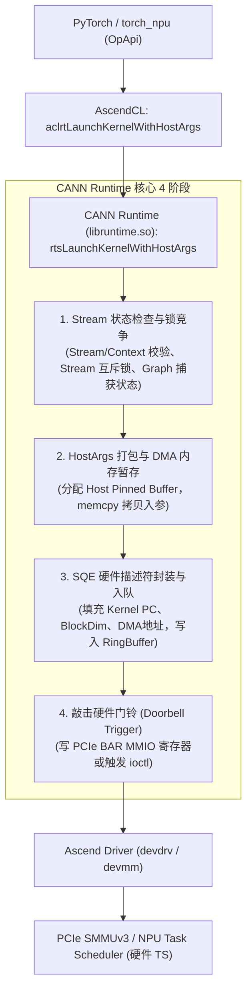

# 昇腾 CANN aclrtLaunchKernelWithHostArgs 算子下发耗时白盒分析报告

> [!IMPORTANT]
> **核心结论概述**：
> 1. **现象量化**：虚机环境下 `aclrtLaunchKernelWithHostArgs` 的单次下发平均耗时为 **48.34 μs**，相比裸机的 **7.08 μs** 放大了 **6.83 倍 (+583%)**，总耗时增加 **375 ms**（占虚机整体性能差距的 51.3%）。同时，单次调用的“底噪”从 2.0 μs 抬升至 17.4 μs（+15 μs 固定损耗），并伴随高达 **4.48 ms** 的偶发性超长尾。
> 2. **白盒根因定位**：算子下发慢并非 NPU 芯片算力不足（纯计算 Kernel 耗时虚机与裸机仅差 1%），而是由虚拟化层在 **硬件门铃 MMIO 陷入、宿主硬中断强行侵入、无静态大页的双重页表 Walk 及 PCIe-NUMA 跨节点访存** 共同作用导致的。

---

## 一、 Profiling 测试数据的核心现象与量化对比

基于本地 `xuji_host_api_us.csv`、`luoji_host_api_us.csv` 及 4-Rank Profiling 数据提取的量化指标如下：

### 1.1 总体统计指标对比 (虚机 vs 裸机)

| 指标维度 | 裸机 (luoji) | 虚机 (xuji) | 差异 / 劣变特征 |
| :--- | :---: | :---: | :--- |
| **调用总次数** | 9,931 次 | 9,206 次 | 算子规模与阶段大体一致（TP8/EP8/MC2） |
| **API 累计总耗时** | 70.28 ms | **445.02 ms** | **虚机总耗时膨胀 6.33 倍（净增 375 ms）** |
| **平均单次耗时 (Mean)** | 7.08 μs | **48.34 μs** | **放大 6.83 倍 (+583%)** |
| **中位数 (Median)** | 6.46 μs | **43.27 μs** | **放大 6.70 倍** |
| **底噪最小值 (Min)** | **2.00 μs** | **17.41 μs** | **基线底噪直接垫高 8.7 倍（+15 μs 固定损耗）** |
| **P90 分位数** | 11.09 μs | **89.95 μs** | 90% 调用延迟劣变近 8 倍 |
| **P95 分位数** | 13.35 μs | **98.06 μs** | 尾部延迟显著拉宽 |
| **P99 分位数** | 20.04 μs | **123.13 μs** | 显著拉宽 |
| **方差 (Variance)** | 12.67 | **3,475.25** | **离散度急剧上升，抖动剧烈** |
| **长尾最大值 (Max)** | 43.77 μs | **4,481.89 μs** | **出现毫秒级超长延迟（放大 100+ 倍）** |
| **$\ge 1.0$ ms 异常调用次数** | **0 次** | **3 次** | 4.48ms (`ScatterNdUpdateSk`), 1.86ms, 1.02ms |
| **下发线程特征** | 单 TID (33302) | 单 TID (16965) | **全部 Launch 集中在单一线程，为严格串行队列** |

### 1.2 虚机 4-Rank 下发梯度与快慢卡连锁反应

在虚机 4-Rank Profiling 中，Host 侧下发呈现明显的非对称梯度：

| Rank | Launch 累计耗时 | 单次平均耗时 | 单次 P90 | 单次 P95 | 集合通信垫底 (迟到) 次数 |
| :---: | :---: | :---: | :---: | :---: | :---: |
| **Rank 0** | **445.02 ms** | **48.34 μs** | **89.96 μs** | **98.06 μs** | **31 次 (93.9%)** |
| **Rank 1** | 428.06 ms | 46.50 μs | 88.22 μs | 95.25 μs | 2 次 (6.1%) |
| **Rank 2** | 409.75 ms | 44.51 μs | 80.20 μs | 86.91 μs | 0 次 |
| **Rank 3** | **388.87 ms** | **42.24 μs** | **78.15 μs** | **84.31 μs** | 0 次 |

> [!CAUTION]
> **快慢卡链条**：即使在最快的 Rank 3 上，平均耗时（42.24 μs）也比裸机慢近 6 倍；而 Rank 0 的串行下发更慢，累计比 Rank 3 多花 **56.15 ms**，导致 Rank 0 频频成为最后一个到达 AllReduce 同步屏障的节点，拖累整机产生多达 **464.43 ms** 的无效通信空等。

---

## 二、 CANN 软件栈白盒执行路径拆解

`aclrtLaunchKernelWithHostArgs` 是 CANN（AscendCL）向 NPU 提交异步计算任务的关键入口，其由上至下的调用流水线如下：

### 2.1 四大执行阶段白盒机理

1. **阶段 1：参数校验与 Stream 上下文（Context & Lock）**
   - 校验 Stream 句柄有效性、核数 BlockDim，获取当前线程对应的 Device/Context。
   - 检查 Stream 是否开启任务队列（`TASK_QUEUE_ENABLE`）或处于图捕获模式。
   - 获取 Stream 内部的提交锁或执行原子指针推进，确保多线程提交安全。

2. **阶段 2：Host 参数打包与 DMA 暂存（Host Args Packaging & DMA Staging）**
   - 与传统接口（要求参数已存在于 Device 显存或通过一级指针数组传递）不同，`aclrtLaunchKernelWithHostArgs` **允许用户直接传入 Host 虚拟内存结构体指针**。
   - **白盒关键点**：Device 端 AI Core 无法直接解析 Host 进程任意未锁页（Unpinned）、非连续的虚拟内存页。因此 CANN Runtime 内部必须：
     1. 从预分配的 Host 锁页内存池（Pinned Memory Pool）中划出一块 DMA 可见缓冲块；
     2. 将用户态 `hostArgs` 结构体内存通过 `memcpy` 拷贝进该缓冲区；
     3. 若内存池打满或碎片化，会退化为系统调用重新申请或跨页映射。

3. **阶段 3：SQE 硬件任务描述符封装与入队（Queue Management）**
   - 将 Kernel 二进制 PC 入口、BlockDim、DMA 参数地址、Workspace 地址、Task ID 封装为硬件指令格式（SQE - Submission Queue Entry，通常 64 或 128 字节）。
   - 将 SQE 追加至与 Stream 绑定的环形提交队列（Ring Buffer）中。
   - 若硬件队列打满（反压 Backpressure），Host 线程将在此自旋（Spin）或等待 Device 侧的 CQE（Completion Queue Entry）上报释放队列槽位。

4. **阶段 4：敲门铃通知硬件调度器（Doorbell / MMIO Register Write）**
   - Runtime 必须告知 NPU 芯片上的硬件调度器（TS - Task Scheduler）新任务就绪。
   - **物理机制**：CPU 对映射到 PCIe BAR 空间的 **Doorbell 硬件寄存器** 执行一次内存写操作（ARM64 汇编为一条 `str` 指令，写入新 SQE 的队尾写指针）。
   - 裸机下该操作仅是一次 PCIe 总线写事务，耗时在 **100 ~ 300 ns** 级别。

---

## 三、 虚机下发时间大幅增加的根因剖析（结合本地环境）

结合本地 `host_isolation_check_20261026_163615.log` 与虚拟机 XML 配置（`instance-00000b34.144vcpu.xml`），虚机下发延迟暴涨由以下四大底层根因引起：

### 根因 1：PCIe BAR 空间 MMIO 门铃访问触发 VM Exit / Stage-2 陷入（底噪 +15 μs 的主因）
* **机理**：在 KVM/QEMU 直通（VFIO）架构下，Guest OS 内向 PCIe BAR 空间的 Doorbell 寄存器写入指令时，必须经过 ARM64 SMMUv3 的 **Stage-2 地址转换（GPA $\rightarrow$ HPA）**。
* **损耗**：
  - 若 QEMU/KVM 在设备直通时未启用直通 MMIO 映射，或硬件门铃触发了 Hypervisor 截获（Trap-and-Emulate），每次写寄存器就会触发一次 **VM Exit（EL1 陷入 EL2 宿主内核）**。
  - 在鲲鹏 920 处理器上，一次 VM Exit/Entry 上下文切换、流水线清空与寄存器存取的往返惩罚约为 **1.5 ~ 3 μs**。
  - 每次 Launch 伴随的寄存器状态查询与 Doorbell 敲击，直接将硬件交互耗时从裸机的 **0.3 μs** 拉长到 **15 ~ 20 μs**，这与 Profiling 中检测到的 **“虚机最低底噪由 2.0 μs 抬升到 17.4 μs”** 表现高度吻合。

### 根因 2：宿主机未配 CPU 隔离参数 + 硬中断肆意侵入 vCPU（毫秒级抖动与长尾的根因）
宿主日志 `host_isolation_check_20261026_163615.log` 暴露了宿主机缺乏低时延调优的严重缺陷：
* **宿主内核参数缺失**：`/proc/cmdline` 中配置为 `nohz=off`，且 **未配置任何 `isolcpus`、`nohz_full`、`rcu_nocbs`**。
* **硬中断未避让隔离核**：`irqbalance` 服务处于 `active` 状态，`IRQBALANCE_BANNED_CPUS` 为空。
  - 采样显示，绑给虚机 vCPU 0/1（对应 pCPU 12, 13）的物理核上，正在疯狂处理大量的外部设备中断：
    - SAS/存储硬中断：`irq/282-hisi_sa`、`irq/322-hisi_sa`
    - 网卡与定时器硬中断：`arch_timer` 局部时钟中断高达 **15 亿次**，伴生大量 `ksoftirqd` 和 `kworker`。
* **对 Launch 的冲击**：
  - Profiling 证实全部 Launch 调用集中在 **单一 Runtime 线程（TID 16965）** 上，执行严格的串行循环。
  - 当该 vCPU 线程在执行参数拷贝、更新环形队列或等待锁时，一旦宿主物理 CPU 被外部硬中断强行打断，vCPU 就会被迫发生 **外部中断 VM Exit** 并让出物理核。
  - 这直接导致单次仅需几十微秒的 Launch 操作被挂起数毫秒，造成了 Profiling 中观测到的 **4.48 ms、1.86 ms、1.02 ms 的三次毫秒级长尾**。

### 根因 3：内存未采用 HugePages 静态大页，依赖 THP 引发页表 Walk 与 Compaction 锁
查看 XML 与宿主机日志：
* `HugePages_Total: 0`，虚机 **完全没有使用 1GB/2MB 静态大页（hugetlbfs）**；
* 宿主机使用的是 `AnonHugePages: 503GB`，且配置为 `THP: [always]`。
* **白盒影响**：
  - **双重页表 Walk（Two-Dimensional Paging）**：普通 4KB 页面下，ARM64 的虚拟化 MMU 在发生 TLB Miss 时，需要遍历 Guest 4 级页表 $\times$ Host 4 级页表（最多 16~24 次内存读取）。CANN Runtime 在频繁写入 `hostArgs` 暂存区和环形描述符时，TLB 命中率严重劣化。
  - **THP 锁与全局 TLB 冲刷（TLB Shootdown）**：`THP [always]` 模式下，内核 `khugepaged` 线程会在后台持续执行内存规整（Compaction）与大页合并。这会长时间持有内存锁（`mmap_lock`），并通过跨核 IPI 广播强刷 TLB，使正在执行连续内存下发的 Runtime 线程陷入异常停顿。

### 根因 4：PCIe 拓扑与 Guest NUMA 节点不匹配，导致跨 Socket 远端访存惩罚
查看虚拟机 XML（`instance-00000b34.144vcpu.xml`）：
* 宿主机的 8 张 NPU 分布在 4 个物理 Socket/NUMA（如 bus 01/02 属于 NUMA 0，bus c1/c2 属于 NUMA 3）；
* 虚机 XML 中为 8 张卡配置了 `pcie-root-port`，但 **全部未配置 `<target numaNode='...'/>` 亲和属性**，且根桥 `numatune` 配置为了 `mode='interleave'`；
* **后果**：
  - Guest OS 识别到的 8 张 NPU 默认全挂在 Guest NUMA 0 上。
  - Rank 0 的 Worker 和 Runtime 线程被绑定在 vCPU 108~125（物理 NUMA 3），但其访问的 NPU 驱动结构、DMA 参数池却交织在物理 NUMA 0 上，每次参数写入和队列刷新都要横跨片间互联总线（Hydra 链路），带来额外的跨节点访存时延，这也是 Rank 0 下发耗时系统性高于 Rank 2/3 的重要原因。

---

## 四、 针对下发时间长的改进与优化建议

针对上述白盒根因，建议从宿主机虚拟化隔离、大页配置、拓扑映射及 CANN 配置四个层面进行调优闭环：

| 优化方向 | 具体实施措施 | 预期收益 |
| :--- | :--- | :--- |
| **1. 宿主机低时延 CPU 隔离** | 在宿主机 `/etc/default/grub` 中添加： `isolcpus=12-47,60-95,108-143,156-191 nohz_full=12-47,60-95,108-143,156-191 rcu_nocbs=12-47,60-95,108-143,156-191` 并在 `/etc/sysconfig/irqbalance` 中配置 `IRQBALANCE_BANNED_CPUS`，禁止中断路由到 vCPU 绑核上。 | **彻底消除毫秒级长尾（4.48ms）与高方差抖动**，防止 Runtime 线程被中断抢占。 |
| **2. 启用 1GB 静态大页 (HugePages)** | 宿主机预留 1GB HugePages，关闭 THP（`echo never > /sys/kernel/mm/transparent_hugepage/enabled`）； XML 中配置 `<memoryBacking><hugepages><page size='1048576' unit='KiB'/></hugepages></memoryBacking>`。 | **降低二维页表穿透开销**，消除后台 Compaction 引起的 TLB Shootdown 停顿。 |
| **3. 修复虚拟 PCIe Root Port 的 NUMA 拓扑** | 在 XML 的 `<controller type='pci' model='pcie-root-port'>` 中显式指定 `<target numaNode='X'/>`，确保每张直通 NPU 与其对应的 vCPU/物理 Socket 完全同 NUMA 对齐。 | **消除跨 Socket 内存访存惩罚**，拉平 Rank 0/1 与 Rank 2/3 的下发梯度。 |
| **4. 调优 CANN 任务队列级别** | 启动脚本中将 `TASK_QUEUE_ENABLE=1` 尝试调整为 **`TASK_QUEUE_ENABLE=2`**（Level 2 深度异步任务队列优化，增强非图模式下的下发批量合并）。 | **减少敲 Doorbell 门铃的频率**，隐藏 Host-Device 交互的 VM Exit 损耗。 |
