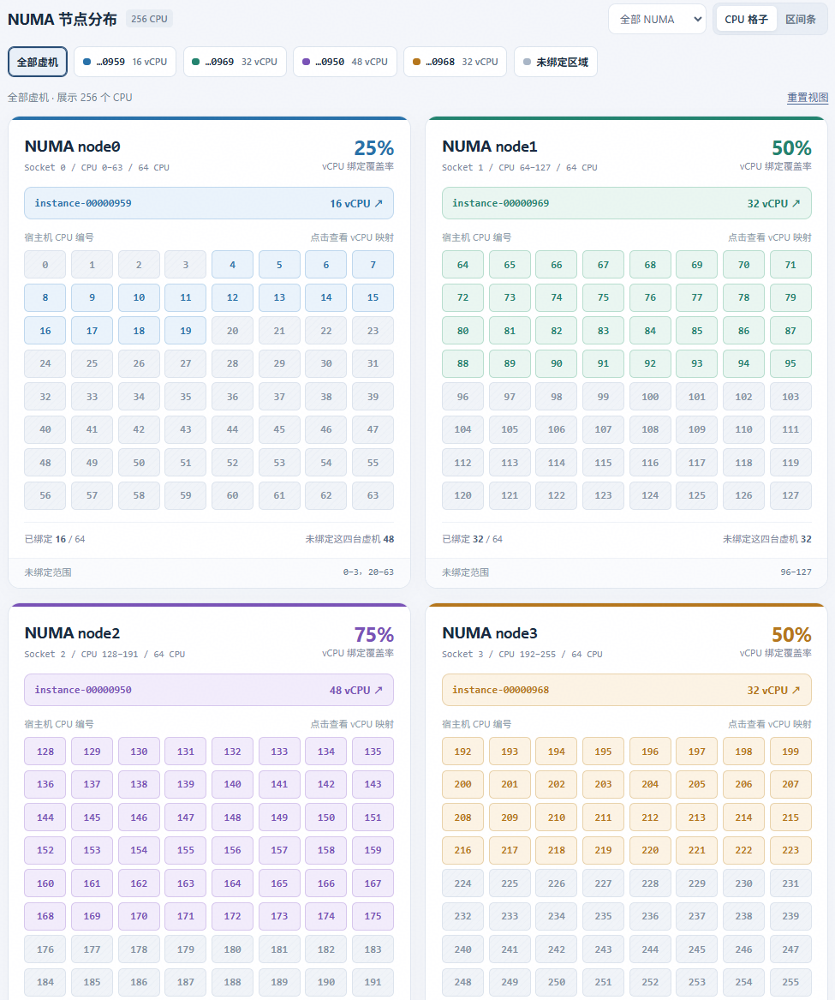
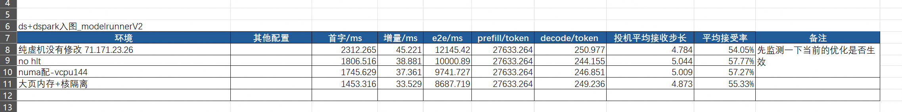
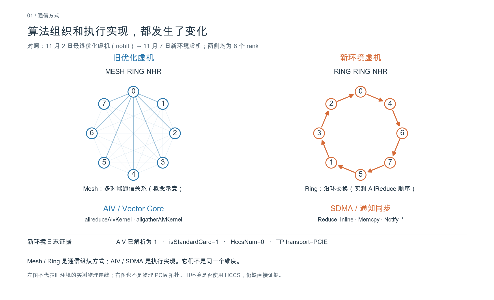
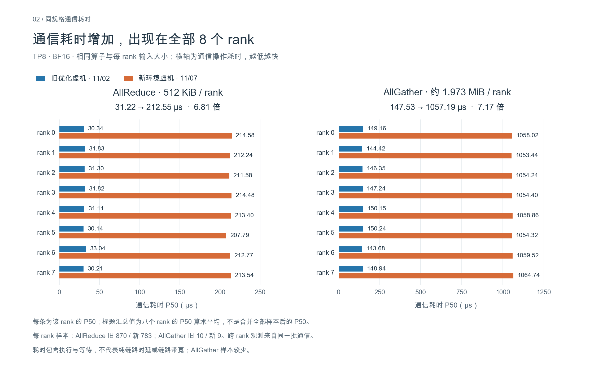
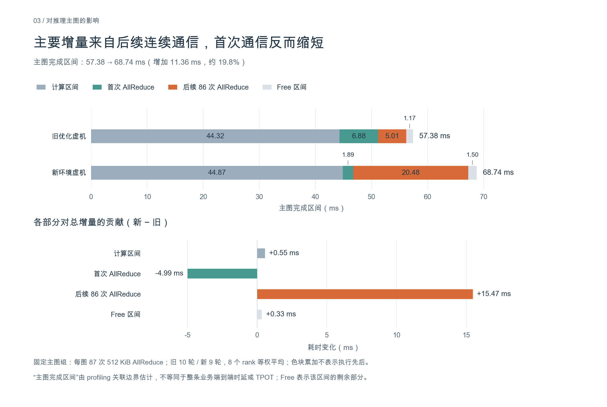

FS https://141.71.127.122:8890 admin/FusionSphere123 fsp/Huawei@CLOUD8 root/Huawei@2026
FM https://141.71.127.123 cloud_admin/FusionSphere123 ossvdcuser/Changeme_123 hwvpc/Changeme_123

管理ip地址：	
172.28.160.62

联调环境1（开发专用1）
【上海绿区英文HANA】27A升级27B
B049版本
OSMU：[https://141.71.123.25:31945/]()
MAE： [https://141.71.123.28:31943/]()
admin/Changeme_456
om: 141.71.123.26 sopuser/Changeme_456
r0: 141.71.123.37 root/Changeme_456

## 宿主机与初始虚机配置

当前的CPU是Kunpeng 920 **7265**，每个CPU上有64个核心

### 关于NPU隔离对于推理性能的影响

在当前环境上应用之前在联调环境3上所使用的虚机推理优化的配置之后，发现在最后的性能依旧不能和裸机持平：

从profiling的结果来看，主要的原因在于卡间通信慢，并且通信方式从mesh转变为ring

解释：
华为 **2024 年版《Atlas 系列硬件产品虚拟机配置指南》**在其覆盖的部署场景中明确说明：**BMC 网络降P启动后，虚机不支持 HCCS。** 这里的降P启动，就包含了对于npu隔离的配置，所以会导致整体性的通信性能的下降

