# 虚机与裸机性能拉齐：优化措施、实现原理与验证结果

版本：V1.0
整理日期：2026-11-03
适用范围：本项目 ARM64 / KVM 虚机上的 Ascend NPU 推理场景

## 1. 优化结论

在本项目相同硬件条件及对齐业务配置的测试中，通过 **①NUMA 重分组与 CPU binding patch、②核隔离、③宿主侧 1 GiB 大页、④Guest idle / VM-exit 路径优化**，虚机业务性能已达到裸机水平。

最新性能记录中，虚机平均端到端时延由初始的 **11275.850 ms 降至 7295.910 ms，下降 35.30%**；对应裸机基线为 **7987.733 ms**。最终虚机记录的首字、增量及端到端时延均不高于裸机基线，支持“当前测试场景已完成性能拉齐”的结论。最后将无效的 `idle=poll` 改为 `nohlt`，是消除剩余业务时延差距的关键步骤。

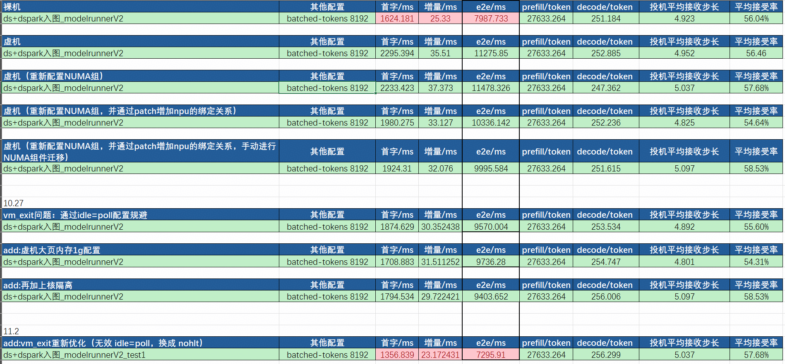
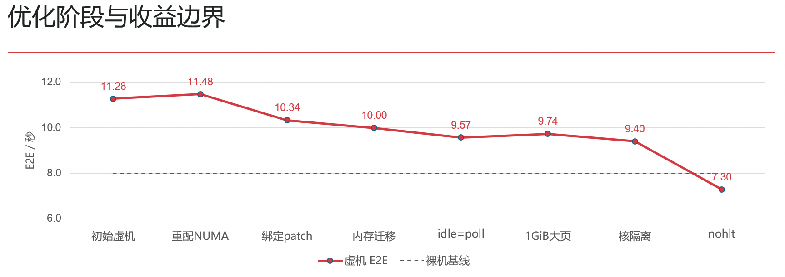

**在优化的过程中发现，在虚机和裸机上纯NPU的计算与通信的速度相差不大，差别主要是在cpu host侧的下发与调度；**
所以这次优化的核心，是让 **NPU 附近的 CPU 和内存能够持续、及时地为设备提供任务**：既缩短跨 NUMA 访问路径，也降低 CPU 调度干扰和地址转换开销，最后减少 Guest 空闲进入 WFI 后带来的虚拟化停驻与唤醒成本。

## 2. 测试范围与优化概览

### 2.1 本文使用的测试口径

| 项目 | 记录中的配置或范围 |
|---|---|
| 业务对比 | `ds+dspark入图_modelrunnerV2` |
| VA 版本及并发 | Excel 标注 VA 0.30rc1、8 并发 |
| 批处理配置 | `batched-tokens 8192` |
| 启动脚本 | TP=8、DP=1、启用 EP；`FULL_DECODE_ONLY`；dspark 投机 token 数为 7 |
| 设备 | Ascend910B4-1 |
| 虚拟化 | ARM64、KVM、NPU PCI 直通 |
| 优化后资源布局 | 144 vCPU、480 GiB 内存、4 个 Guest NUMA 节点 |

### 2.2 四项优化及其分工

| 优化项  | 解决的问题 |
|---|---|
| NUMA 与 CPU/NPU/内存亲和性  | CPU、内存和 NPU 放置不一致造成的远端访问及线程迁移 |
| 核隔离  | 系统维护、调度 tick、中断及后台线程对关键 vCPU 的干扰 |
| 1 GiB 大页 | 大容量内存映射中的页表与地址转换压力 |
| VM-exit 路径 | Guest idle 进入 WFI 后的 KVM 处理、vCPU 停驻及唤醒重入开销 |

## 3. 优化一：NUMA 重分组与 CPU binding patch

### 3.1本项目的实现

NUMA 节点：一组 CPU 核，以及与这些 CPU 核距离较近的一部分主机内存。

https://wiki.huawei.com/domains/169712/wiki/391871/WIKI2026103113636549

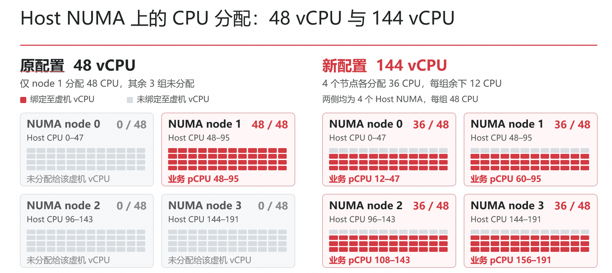

原来推理服务所使用的虚机环境是占据了一个NUMA组的所有cpu，但是这样会导致vcpu在访问远端的NPU的耗时较高，因为主机侧访问这些设备时要跨节点；

运行域配置将 144 个 vCPU 分成四组，每组 36 个，分配 120 GiB 内存；vCPU 固定到对应宿主 CPU，内存通过每 cell 的 `memnode mode='strict'` 绑定到对应宿主 NUMA。

| Guest NUMA | Guest vCPU | Host CPU | Host NUMA | 内存 |
|---|---|---|---|---:|
| 0 | 0–35 | 12–47 | 0 | 120 GiB |
| 1 | 36–71 | 60–95 | 1 | 120 GiB |
| 2 | 72–107 | 108–143 | 2 | 120 GiB |
| 3 | 108–143 | 156–191 | 3 | 120 GiB

结合 vCPU pinning，实际映射为：

| 逻辑 NPU | Guest CPU 池 | Guest / Host NUMA | 映射后的 Host CPU |
|---|---|---:|---|
| 0 | 108–125 | 3 | 156–173 |
| 1 | 126–143 | 3 | 174–191 |
| 2 | 72–89 | 2 | 108–125 |
| 3 | 90–107 | 2 | 126–143 |
| 4 | 0–17 | 0 | 12–29 |
| 5 | 18–35 | 0 | 30–47 |
| 6 | 36–53 | 1 | 60–77 |
| 7 | 54–71 | 1 | 78–95 |

这套编号是本项目实例的配置，迁移部署时应根据实际 NPU PCI 拓扑重新映射。

### 3.2 NUMA组与CPU的绑定关系

在vllm-ascend较新的版本中，cpu-binding是默认开启的，具体的方式是在当前的执行环境中执行
1、`npu-smi info -m`
2、`npu-smi info -t topo`
3、`lscpu -e=CPU,NODE`
然后根据上述命令的执行结果，来确认最终的绑核方式；我们之前调整NUMA的绑核等，就是为了在va启动时可以启动绑核。
https://docs.vllm.ai/projects/ascend/zh-cn/v0.27.1rc1/developer_guide/Design_Documents/cpu_binding.html?utm_source=chatgpt.com

但是存在一个问题，在虚机环境中，npu-smi info -t topo这个命令是不支持的：

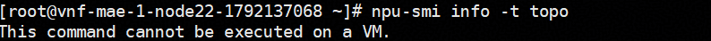

所以导致了最后的cpu绑核会fallback到globe_slice这种方式，就是顺序（随机）给每个NUMA组去分配绑定的NPU，但是这样会导致分配的结果和实机的NUMA绑定关系并不符合：
最初的分配方式：
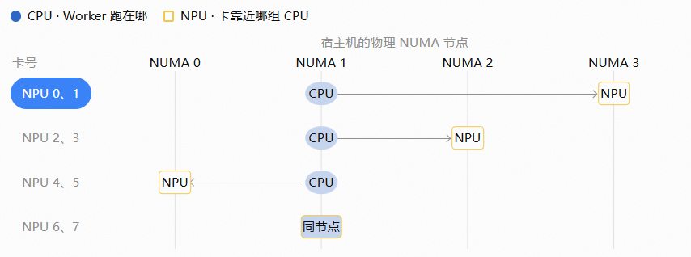
虚机NUMA组重配后的分配方式：

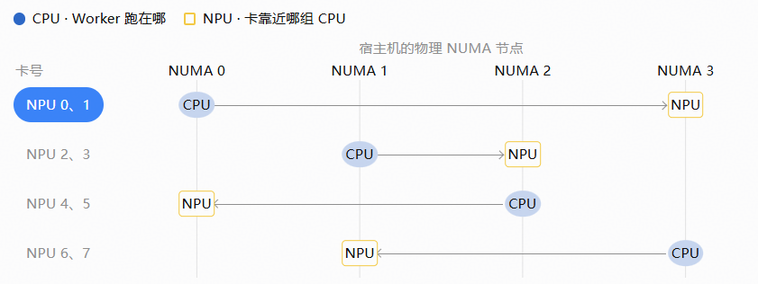

所以这里的分配，甚至比优化之前还有恶化，因为相当于将跨NUMA组访问的数量从3增加到4，从测试的平均时延的结果上也能证明。（也顺便证明了虚机的性能gap不在vcpu核的数量）

#### 解决方式：

通过增加patch的方式：
应用侧 patch 增加 `LOCAL_ASCEND_CPU_POOLS`，按**全局逻辑 NPU ID** 显式指定 Guest CPU 池。当前 144 vCPU 启动脚本增加使用：

```bash
export LOCAL_ASCEND_CPU_POOLS='{"0":"108-125","1":"126-143","2":"72-89","3":"90-107","4":"0-17","5":"18-35","6":"36-53","7":"54-71"}'
```

### 3.3结果如何体现

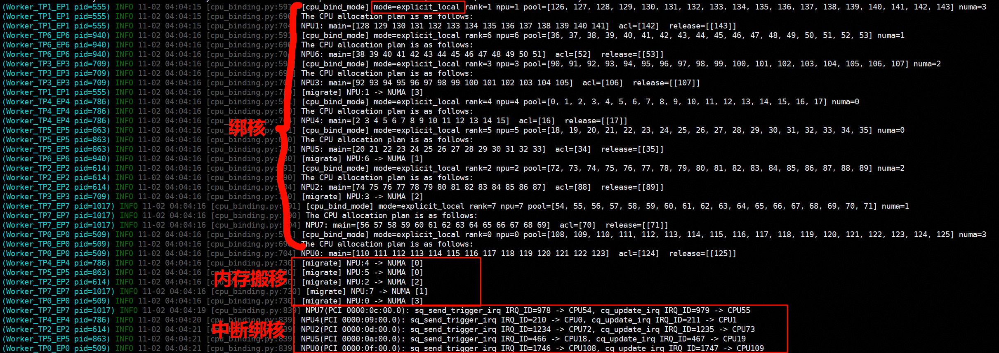

当前VA的逻辑是，先拉起服务，然后将绑核与内存迁移放到最后；

patch 校验 CPU 池不重叠、不跨 Guest NUMA，且 CPU 位于允许集合内；同时检查必需的 NPU 是否都有映射。启动日志中八个 worker 均打印了 `mode=explicit_local`，可确认显式池分配被实际采用。每张 NPU 分到 18 个 vCPU，其中日志显示 2 个用于设备 IRQ，14 个用于主线程 CPU 集合，1 个用于 ACL/Runtime，1 个用于 release。以 NPU0 为例：

```text
pool    = 108–125，numa=3
IRQ     = 108、109
main    = 110–123
acl     = 124
release = 125
```

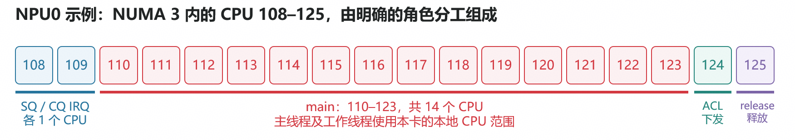

仅重配 NUMA 时，E2E 为 11478.326 ms；加入绑定 patch 后降至 10336.142 ms，再加入手动迁移后为 9995.584 ms。记录说明了应用绑定与内存放置需要配套完成，也说明“改了 NUMA 拓扑”本身不足以保证收益。上述是阶段结果，不是各措施的独立消融结论。

### 3.4 后续展望：

1、Cpu bing patch
*临时的一个解决方案，需要提前知道在虚机上的NUMA分配方式，再提前按照进行ptach，后续可以讨论出更加合理的解决方式；*

*本质原因是当前的npu亲和性下的编号不是顺序的，导致va在虚机环境上fall back到global slice了，可以在配置虚机配置文件xml的时候，乱序，将顺序调整到符合id 顺序的numa组分配方式*

2、fs平台配置：*https://76.65.173.3:644/website/#/ResourceManagement

可能需要新增一种虚机配置方案，之前和相关同事交流的结果说是：**平台可能不支持这样进行配置***

## 4. 优化二：核隔离，降低关键 CPU 的运行抖动

### 4.1 为什么要配置核隔离？

**减少宿主机对虚机推理线程的打断，让 CPU 能更稳定地向 NPU 下发算子**
例如：CPU 12 中途处理了一个宿主机网卡中断，中断处理期间，推理线程暂停。等 CPU 12 回来，线程才能继续，所以这次调用测出来更长
经过配置后，将这 144 个核从普通调度负载均衡中隔离出来，只处理推理相关的业务；

### 4.1 已实施配置

宿主每个 NUMA 节点划出 36 个 CPU 承载虚机 vCPU，其余 12 个用于系统维护等任务。

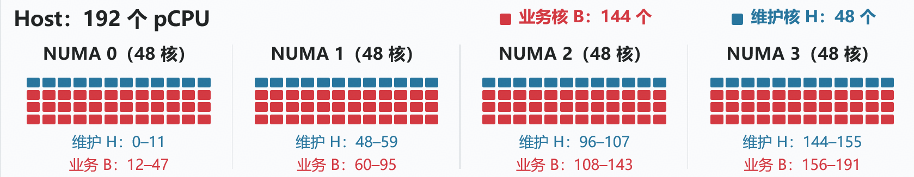

| 用途 | Host CPU 集合 | 数量 |
|---|---|---:|
| 虚机业务 vCPU | `12-47,60-95,108-143,156-191` | 144 |
| 系统维护及默认 IRQ | `0-11,48-59,96-107,144-155` | 48 |
| QEMU emulator 允许集合 | `0-3,48-51,96-99,144-147` | 16，属于维护 CPU 子集 |

现场宿主启动参数摘录：

```text
isolcpus=managed_irq,domain,nohz,12-47,60-95,108-143,156-191
nohz_full=12-47,60-95,108-143,156-191
rcu_nocbs=12-47,60-95,108-143,156-191
rcu_nocb_poll
skew_tick=1
irqaffinity=0-11,48-59,96-107,144-155
```

### 4.2 生效原理

| 配置 | 作用 |
|---|---|
| `isolcpus=domain` | 从普通调度负载均衡域中隔离指定 CPU，配合显式绑定安排业务线程 |
| `nohz_full` / `isolcpus=nohz` | 满足条件时减少调度 tick，降低周期性干扰，并非关闭全部定时器与中断 |
| `rcu_nocbs` | 将指定 CPU 的 RCU 回调处理卸载到内核线程；仍需关注相关线程实际落点 |
| `irqaffinity` / `managed_irq` | 将默认 IRQ 引向维护 CPU，并尽力避开隔离 CPU；最终效果受具体 IRQ 和队列配置影响 |
| `emulatorpin` | 约束 QEMU emulator 线程，减少其与业务 vCPU 竞争

对于 TP8 推理，一个 rank 的短暂迟到可能让其余 rank 在集合通信处等待。核隔离主要改善 Host 提交的及时性和稳定性，收益可以表现为跨 rank 等待减少，而不一定是 NPU 算子自身计算变快。

### 4.3 阶段结果

加入核隔离的记录中，E2E 从 9736.280 ms 降到 9403.652 ms，增量指标从 31.511 ms 降到 29.722 ms。该阶段仍比裸机 E2E 高 17.73%，说明隔离改善了运行条件，但剩余 idle / 唤醒路径问题尚未消除。

## 5. 优化三：宿主侧 1 GiB 大页内存

### 5.1 为什么要配置大页内存？

减少 CPU 在访问虚机内存时，花在地址转换上的时间：

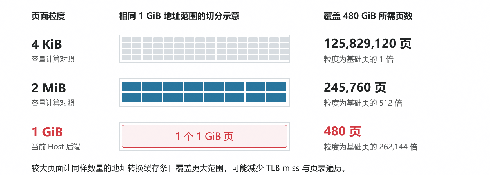

CPU 通过 TLB 缓存地址转换结果。页面更大时，同等内存容量所需的映射项更少，通常有助于降低 TLB 压力和页表遍历成本。虚拟机还涉及 Guest 地址转换及 KVM 的 Stage-2 转换；连续、对齐的大页后端为采用更大粒度的映射提供条件

### 5.2 大页配置在哪一层

本项目的“1 GB 大页”，准确说是 **宿主使用 1 GiB HugeTLB 页面为 QEMU Guest RAM 提供后端**。运行域配置为：
虚机配置：

```xml
<memoryBacking>
  <hugepages>
    <page size='1048576' unit='KiB'/>
  </hugepages>
</memoryBacking>
```

### 5.3 已证明与未单独量化的效果

当前记录已经证明 480 GiB Guest RAM 使用宿主 1 GiB HugeTLB，并按四节点分布。阶段测试中，加入大页后首字从 1874.629 ms 改善为 1708.883 ms，但 E2E 从 9570.004 ms 增至 9736.280 ms。

所以，大页应列为已完成的基础优化，本文不为其宣称独立、稳定的 E2E 降幅。它也不等于 NPU 参数 BAR-copy/WC 快速路径开关；两者的作用对象不同。

## 6. 优化四：通过 nohlt 改善 Guest idle 与 VM-exit 路径

VM-exit 优化原理：减少虚拟机退出到宿主机的次数，降低 CPU 虚拟化切换开销，从而提升推理性能。
虚拟机（Guest）运行时，某些操作会触发 CPU 从 Guest 切换到宿主机的 KVM/Hypervisor 处理，然后再返回 Guest。

例如，Guest 执行 `<span>WFI</span>`（Wait For Interrupt，等待中断）时，可能触发 VM-exit。

### 6.1 从 idle=poll 到 nohlt

前期尝试以 `idle=poll` 规避 idle 相关退出，后续确认这个配置只针对x86架构的CPU生效；
后续改用 `nohlt` 后（该配置是arm架构下的配置），业务性能恢复到裸机水平；

这里改变的是 **Guest 内核空闲行为**，不是一个名为 `vm_exit` 的统一开关，也不是禁止全部虚拟化退出。

### 6.2 为什么 nohlt 在本环境有效

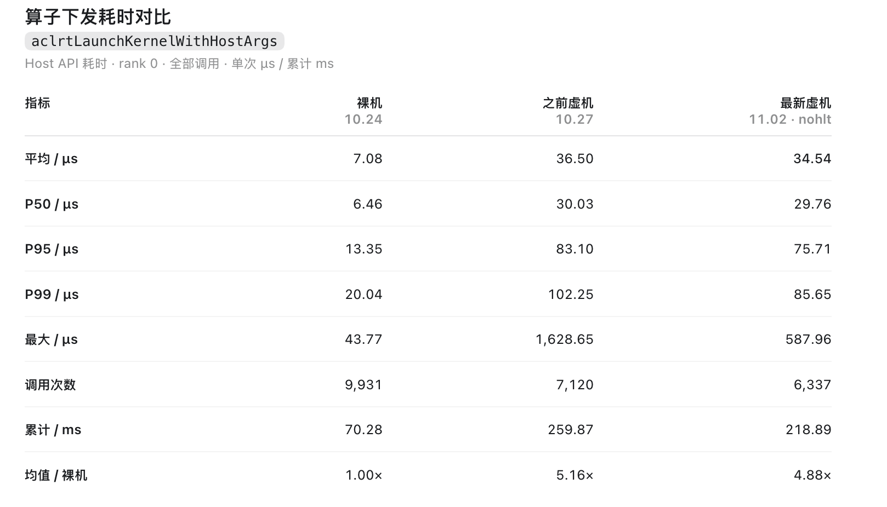
在之前对于虚机、裸机的profiling分析的结果中，发现虚机相较于裸机的算子下发的时间有明显的提高；在最新的nohlt优化后的结果依然如此，但是最终的平均端到端时延却是已经和裸机持平了，原因如下：

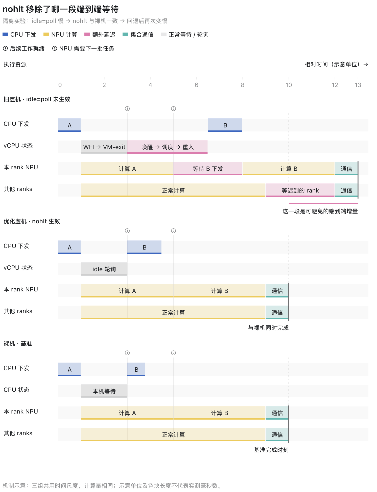

```text
原路径的额外等待来源：
Guest CPU 暂无可运行任务 → idle / WFI → KVM 处理与可能的 vCPU 停驻
    → 等待唤醒与重新运行 → Host 任务提交迟到 → 其他 rank 同步等待

nohlt 的作用方向：
Guest CPU 空闲时轮询 → 减少上述 idle 进入 WFI 的机会
    → 任务就绪后更及时运行 → 降低关键提交路径上的额外等待
```

这是结合配置、历史退出计数和业务回退结果形成的机制解释。nohlt 的业务效果已经有回退验证支持，但尚无前后同窗口退出计数与每次请求的逐事件关联，不能给出“减少了多少百分比 VM exit”或每个内部环节的耗时占比。

### 6.3 性能效果与使用代价

在已完成亲和性、大页、核隔离的基础上，改用 nohlt 后，E2E 从 9403.652 ms 降为 7295.910 ms，阶段记录下降 **22.41%**。该数值是两条汇总记录的比较；回退验证支持 nohlt 是剩余业务差距的关键配置。

轮询以更多 CPU 占用和功耗换取更短的空闲唤醒延迟。本项目有专用 CPU 池和核隔离作为配套条件。迁移到 CPU 超分或多租户环境时，应重新评估资源竞争；`nohlt` 也不会消除 MMIO、中断等其他原因的退出。

## 7. 性能结果汇总

全部数值来自最新 Excel 的 `030` 工作表，保持同一业务行系列；时延单位为 ms。

| 阶段 | Excel 行 | 首字 | 原表增量 | E2E | E2E 相对裸机 |
|---|---:|---:|---:|---:|---:|
| 裸机基线 | 40 | 1624.181 | 25.330 | 7987.733 | 基线 |
| 初始虚机 | 43 | 2295.394 | 35.510 | 11275.850 | +41.16% |
| 重配 NUMA | 46 | 2233.423 | 37.373 | 11478.326 | +43.70% |
| 增加 NPU / CPU 绑定 patch | 49 | 1980.275 | 33.127 | 10336.142 | +29.40% |
| 加入手动 NUMA 页迁移 | 52 | 1924.310 | 32.076 | 9995.584 | +25.14% |
| 尝试 idle=poll | 57 | 1874.629 | 30.352 | 9570.004 | +19.81% |
| 加入 1 GiB 大页 | 60 | 1708.883 | 31.511 | 9736.280 | +21.89% |
| 加入核隔离 | 63 | 1794.534 | 29.722 | 9403.652 | +17.73% |
| 改用 nohlt，11 月 2 日 | 68 | **1356.839** | **23.172** | **7295.910** | **−8.66%** |

