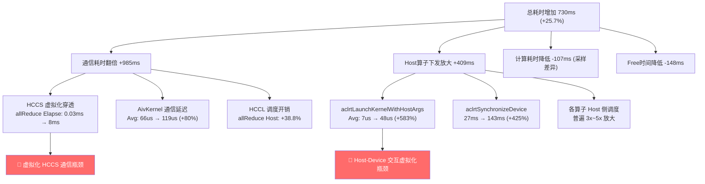

# 昇腾 Ascend vLLM Profiling 虚机 vs 裸机 对比分析报告

> [!IMPORTANT]
> **核心结论：虚机（xuji）相比裸机（luoji）总体耗时增加约 25.7%，其中通信开销翻倍是第一大瓶颈，Host侧算子下发开销放大约 4x 是第二大瓶颈。**

---

## 1. 环境基本信息

| 项目 | 裸机 (luoji) | 虚机 (xuji) |
|------|-------------|-------------|
| torch_npu 版本 | 2.10.0.post6 | 2.10.0.post6 |
| CANN 版本 | 9.1.0 | 9.1.0 |
| Rank | 0 | 0 |
| TP 并行组 | 8 卡 (0-7) | 8 卡 (0-7) |
| EP 并行组 | 8 卡 (0-7) | 8 卡 (0-7) |
| MC2 并行组 | 8 卡 (0-7) | 8 卡 (0-7) |
| 内存分配策略 | expandable_segments:True | expandable_segments:True |
| Profiler PID | 33217 | 16881 |

> [!NOTE]
> 两个环境的软件栈完全一致（CANN 9.1.0 + torch_npu 2.10.0.post6），并行配置也相同（TP8/EP8/MC2），差异纯粹来自虚拟化层。

---

## 2. Step Trace Time 总览对比（核心差异）

```mermaid
xychart-beta
    title "Step Trace Time 对比 (ms)"
    x-axis ["Computing", "Communication", "Free", "Stage Total"]
    y-axis "时间 (ms)" 0 --> 3600
    bar [1299, 913, 626, 2838]
    bar [1192, 1898, 479, 3568]
```

| 指标 | 裸机 (luoji) | 虚机 (xuji) | 差值 | 增长比例 |
|------|:----------:|:----------:|:----:|:-------:|
| **Computing (us)** | 1,298,715 | 1,191,977 | -106,738 | **-8.2%** ⬇️ |
| **Communication (Not Overlapped, us)** | 912,514 | 1,897,609 | **+985,095** | **+108%** ⬆️⬆️ |
| **Communication Overlapped (us)** | 0 | 0 | 0 | — |
| **Free (us)** | 626,411 | 478,745 | -147,666 | -23.6% |
| **Preparing (us)** | 4,905 | 560 | -4,346 | -88.6% |
| **Stage Total (us)** | 2,837,641 | 3,568,332 | **+730,691** | **+25.7%** ⬆️ |

> [!CAUTION]
> **通信耗时翻倍**（912ms → 1898ms）是虚机性能 gap 的主要来源，直接贡献了 985ms 的增量，占总增量的 **134%**（计算耗时反而略有下降，部分抵消了通信增量）。

### 时间分布占比变化

| 阶段 | 裸机占比 | 虚机占比 |
|------|:------:|:------:|
| Computing | 45.8% | 33.4% |
| Communication | 32.1% | **53.2%** |
| Free | 22.1% | 13.4% |

---

## 3. 通信详细分析

### 3.1 HCCL 通信算子

| 通信算子 | 裸机 (luoji) | 虚机 (xuji) | 差值 |
|---------|:----------:|:----------:|:----:|
| **hcom_allReduce (Host 调度时间, us)** | 27,590 (174次) | 38,304 (174次) | **+38.8%** |
| hcom_allReduce Avg(us) | 158.6 | 220.1 | +38.8% |
| **hcom_allGather (Host 调度时间, us)** | 5,930 (28次) | 5,939 (24次) | ≈持平 |

### 3.2 通信 Elapse Time 模式对比

**裸机 allReduce** 的单次 Elapse Time 多数在 **0.01ms ~ 0.2ms** 级别（微秒级快速完成）。

**虚机 allReduce** 的单次 Elapse Time 大幅上升到 **5ms ~ 14ms** 级别：
- 典型值：6.3ms / 7.0ms / 7.5ms / 8.0ms / 8.5ms / 10.3ms / 11.5ms / 12.6ms / 13.8ms
- 呈现明显的 **4 步交替模式**（约 7ms / 8ms / 8ms / 12ms 交替）

> [!WARNING]
> 虚机的 allReduce 通信 Elapse Time 相比裸机放大了 **约50~100倍**。这说明虚拟化层在 HCCS（芯片间互联）通信路径上引入了巨大的额外延迟。即使做了 NUMA 和 CPU 组的绑定优化，HCCS 的虚拟化穿透仍然存在严重的性能损耗。

### 3.3 AivKernel 通信内核

| 指标 | 裸机 (luoji) | 虚机 (xuji) | 增幅 |
|------|:----------:|:----------:|:----:|
| 总耗时(us) | 13,342 | 23,542 | **+76.5%** |
| 平均(us) | 66.0 | 118.9 | **+80.0%** |
| 最大(us) | 114.7 | 204.2 | +78.0% |
| 调用次数 | 202 | 198 | ≈持平 |

---

## 4. Host 侧算子下发开销分析（第二大瓶颈）

### 4.1 aclrtLaunchKernelWithHostArgs（核心算子下发接口）

| 指标 | 裸机 (luoji) | 虚机 (xuji) | 增幅 |
|------|:----------:|:----------:|:----:|
| **总耗时(us)** | 70,280 | **445,018** | **+533%** ⬆️⬆️⬆️ |
| 平均(us) | 7.08 | **48.34** | **+583%** |
| 最大(us) | 43.77 | 4,481.89 | +10139% |
| 调用次数 | 9,931 | 9,206 | -7.3% |
| 方差 | 12.67 | 3,475.25 | — |

> [!CAUTION]
> **aclrtLaunchKernelWithHostArgs 是最显著的单项性能差异**。虚机的算子下发平均耗时是裸机的 **6.8 倍**，总耗时增加了 **375ms**。这说明虚拟化层在 Host→Device 的 Kernel Launch 路径上存在严重瓶颈（可能是 PCIe 虚拟化、IOMMU/vIOMMU 开销、vCPU 调度抖动等）。

### 4.2 其他 Host 侧关键 API 开销对比

| API | 裸机 Total(us) | 虚机 Total(us) | 增幅 | 说明 |
|-----|:------------:|:------------:|:----:|------|
| `aclrtRecordEvent` | 23,148 | 41,138 | +77.7% | Event 记录 |
| `aclrtStreamWaitEvent` | 13,787 | 24,480 | +77.6% | Stream 同步等待 |
| `aclrtCreateEventExWithFlag` | 8,988 | 12,971 | +44.3% | Event 创建 |
| `aclrtSynchronizeDeviceWithTimeout` | 27,268 | **143,244** | **+425%** | 设备同步 |
| `aclrtDestroyEvent` | 2,116 | 3,098 | +46.4% | Event 销毁 |
| `aclrtMemcpyAsync` | 8,531 | 11,882 | +39.3% | 异步数据搬运 |
| `node launch (总计)` | 134,275 | **542,977** | **+304%** | 所有节点下发总计 |

### 4.3 典型算子 Host 调度开销放大

| 算子 | 裸机 Avg(us) | 虚机 Avg(us) | 增幅 |
|------|:----------:|:----------:|:----:|
| `aclnnCompressor` | 36.3 | **158.7** | +337% |
| `aclnnHcPre` | 29.4 | **139.0** | +373% |
| `aclnnHcPost` | 28.0 | **81.7** | +192% |
| `aclnnDequantSwigluQuantV2` | 28.5 | **92.9** | +226% |
| `aclnnCumsum` | 45.2 | **92.7** | +105% |
| `aclnnSparseAttnSharedkv` | 34.9 | **162.7** | +366% |
| `aclnnQuantMatmulWeightNz` | 20.3 | **117.6** | +480% |
| `aclnnMoeInitRoutingV3` | 20.3 | **118.9** | +486% |
| `aclnnDynamicQuantV2` | 16.8 | **67.5** | +302% |
| `aclnnRmsNorm` | 24.3 | **79.9** | +229% |
| `aclnnForeachAddListV2` | 19.0 | **76.9** | +305% |
| `aclnnInplaceCopy` | 16.5 | **49.4** | +199% |
| `aclnnInplaceFillScalar` | 12.6 | **50.7** | +303% |
| `aclnnMoeGatingTopKHash` | 28.2 | **85.4** | +203% |

---

## 5. NPU Device 侧计算算子对比

### 5.1 Top 算子设备耗时对比

| 算子 | 裸机 Total(us) | 虚机 Total(us) | 差值 | 说明 |
|------|:------------:|:------------:|:----:|------|
| SparseAttnSharedkv | 195,037 (644次) | 203,060 (552次) | +4.1% | Attention 核心 |
| HcPre | 169,421 (1288次) | 156,896 (1104次) | -7.4% | HC 预处理 |
| GroupedMatmulSwigluQuant | 157,516 (644次) | 136,507 (552次) | -13.3% | MoE 专家矩阵乘 |
| VllmAscendQuantLightningIndexerV2 | 107,521 (294次) | 101,568 (252次) | -5.5% | vLLM 量化索引 |
| Compressor | 86,786 (868次) | 76,967 (744次) | -11.3% | 压缩 |
| QuantBatchMatmulV3 | 78,272 (2912次) | 72,133 (2496次) | -7.8% | 量化矩阵乘 |
| InplacePartialRotaryMul | 67,821 (2226次) | 68,311 (1908次) | +0.7% | RoPE |
| GroupedMatmul | 75,919 (644次) | 66,543 (552次) | -12.4% | 分组矩阵乘 |
| HcPost | 70,717 (1288次) | 65,672 (1104次) | -7.1% | HC 后处理 |
| MatMulV2 | 61,123 (2226次) | 53,933 (1896次) | -11.8% | 矩阵乘 |

> [!TIP]
> **Device 侧的计算算子耗时虚机和裸机基本持平甚至虚机略低**。这是因为 NPU 算力不受虚拟化影响（设备直通），调用次数不同是因为采样到的 step/token 数不同。算子的 **Avg Time** 两者差异很小（<10%），说明 NPU 自身的计算能力没有被虚拟化削弱。

### 5.2 每次调用平均耗时对比（排除批次差异）

| 算子 | 裸机 Avg(us) | 虚机 Avg(us) | 差值 |
|------|:----------:|:----------:|:----:|
| SparseAttnSharedkv | 302.9 | 367.9 | +21.5% |
| HcPre | 131.5 | 142.1 | +8.1% |
| GroupedMatmulSwigluQuant | 244.6 | 247.3 | +1.1% |
| VllmAscendQuantLightningIndexerV2 | 365.7 | 403.0 | +10.2% |
| Compressor | 100.0 | 103.4 | +3.5% |
| QuantBatchMatmulV3 (MIX_AIC) | 26.9 | 28.9 | +7.5% |
| InplacePartialRotaryMul | 30.5 | 35.8 | +17.5% |
| GroupedMatmul | 117.9 | 120.5 | +2.3% |
| HcPost | 54.9 | 59.5 | +8.4% |
| MatMulV2 | 27.5 | 28.4 | +3.6% |
| Cumsum (AI_CPU) | 35.2 | 33.5 | -4.7% |

> [!NOTE]
> 大部分算子的单次执行耗时差异在 10% 以内，属于正常波动。**SparseAttnSharedkv (+21.5%) 和 InplacePartialRotaryMul (+17.5%)** 稍有偏大，可能与虚机环境下的 cache 命中率和内存访问延迟相关。

---

## 6. 根因分析与架构图

---

## 7. 结论与建议

### 7.1 性能 Gap 归因分解

| 瓶颈类别 | 贡献量 | 占总 Gap 比例 | 严重程度 |
|---------|:-----:|:----------:|:-------:|
| **HCCS 通信虚拟化延迟** | ~985ms | ~135% (被计算抵消) | 🔴 极高 |
| **Host→Device 算子下发延迟** | ~409ms | ~56% | 🔴 极高 |
| 设备同步开销 | ~116ms | ~16% | 🟡 中等 |
| NPU 计算耗时差异 | ≈0 | ≈0% | 🟢 可忽略 |

### 7.2 优化建议

> [!IMPORTANT]
> **第一优先级：解决通信虚拟化穿透问题**

1. **HCCS 通信路径优化**
   - 确认虚机是否真正实现了 NPU HCCS 链路的直通（pass-through），而非经过 vIOMMU 转发
   - 检查 HCCS 的 RDMA 链路是否在虚拟化后降级为 PCIe 路径
   - 建议联系华为确认虚拟化场景下 HCCS 的最佳配置

2. **Host→Device 交互优化**
   - 检查 vIOMMU 是否开启，尝试使用 PT（Pass-Through）模式绕过 IOMMU
   - 确认 PCIe ACS (Access Control Services) 的配置
   - 检查 vCPU 是否绑定到与 NPU 同一 NUMA 节点的物理 CPU
   - 考虑增大 MMIO 映射区域，减少 trap-and-emulate

3. **vCPU 调度优化**
   - `aclrtLaunchKernelWithHostArgs` 方差极大（3475 vs 12.7），暗示 vCPU 调度抖动
   - 建议给虚机的 vCPU 配置 `isolcpus` + `nohz_full` 减少内核干扰
   - 考虑使用 `fifo` 实时调度策略

4. **MindStudio 进一步分析**
   - 建议使用 MindStudio 打开两份 `trace_view.json` 进行时间线对比
   - 重点关注 allReduce 前后的 gap 和 kernel launch 的 bubble

### 7.3 关键发现总结

- ✅ **NPU 算力未受影响** — Device 侧计算算子单次耗时差异 <10%
- ❌ **HCCS 多卡通信严重劣化** — allReduce 通信延迟从 0.03ms 膨胀到 8ms（~200x）
- ❌ **Host 侧算子下发开销大幅膨胀** — LaunchKernel 平均耗时从 7us 涨到 48us（~7x）
- ❌ **设备同步开销飙升** — SynchronizeDevice 从 27ms 涨到 143ms（~5x）
- 🔍 **NUMA 绑定可能未完全生效** — Launch 的高方差暗示仍存在跨 NUMA 访问或 vCPU 抢占

